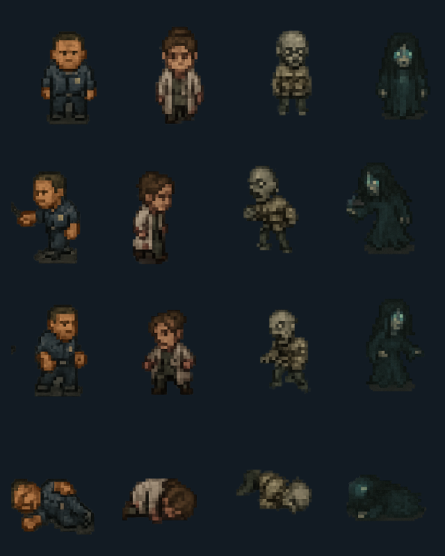

# Hero art bible · Pack 05 reference pass

Columns: **Elias · Miriam · Subject 13 · Anya**. Rows: **idle · attack · cast · death**. This is a production reference proposal for review, **not a claim of final art-direction approval**. The four legacy sheets remain the source art; the pipeline makes them usable and animated without inventing new poses. Future hand-authored sprite replacements can keep the contract.

## Direction

- **Language:** restrained, readable horror pixel art. Muted institutional colors over near-black/navy UI; one accent per protagonist. Avoid noisy backgrounds inside sprite frames and keep each silhouette legible at 48–96 px display height.
- **Palette anchors:** UI ink `#121b23`; Elias slate `#334653` and warm skin `#b8845b`; Miriam bone coat `#aea99b` and burgundy `#5f363a`; Subject 13 ash `#777866` and sickly olive `#777c57`; Anya deep teal `#183739` and cold glow `#8bc6b6`. These are targets for future repainting, not a claim that every legacy source pixel matches exactly.
- **Silhouettes:** Elias broad/short-armed security silhouette; Miriam narrow lab-coat and raised hair; Subject 13 compact, bandaged and pallid; Anya tall hood/long robe with a teal face/glow. These differences must survive monochrome tests and 64 px HUD rendering.
- **Scale:** source sheet 1024×1024, four columns by three rows, each source cell 256×320; bottom 64 px is gutter. Generated RGBA atlases are 512×512 with 128×160 cells. Keep the full figure and feet aligned to pivot `(0.5, 0.92)` in a cell. Draw at native or integer multiples where possible; no baked background or checkerboard.

## Animation contract

All four protagonists share the same frame grid and state names in [`hero-atlas-contract.json`](../src/assets/hero-atlas-contract.json). Index = row × 4 + column. The renderer owns current-state timing; the combat rules remain independent of DOM frames.

| State | Frames | Timing | Usage |
| --- | --- | --- | --- |
| `idle` | 0, 3 | 500 ms loop | HUD and neutral combat |
| `walkNorth` | 1, 2 | 180 ms loop | exploration movement |
| `walkSouth` | 4, 5 | 180 ms loop | exploration movement |
| `walkEast` / `walkWest` | 6, 7 | 180 ms loop; west mirrored | exploration movement |
| `attack` | 7, 8 | 140 ms, hold final | basic attack |
| `cast` | 9, 10 | 180 ms, hold final | ability, item or defense |
| `hit` | 6, 10 | 120 ms, hold final | HP lost during resolved turn |
| `death` | 11 | static | fallen party member |

Reduced-motion mode uses the first frame of each state. Enemy/boss art and impact effects belong to Pack 06; this pass intentionally does not fabricate enemy poses.

## Pipeline and review gate

`npm run sprites:build` derives four atlases and this sample from the original sheets under `source-assets/assets/sprites/characters/`. `npm run sprites:check` recomputes them and fails if a generated file is stale, any frame is empty, the dimensions are wrong or true alpha is absent. Anya's opaque dark checker matte is removed via a bounded flood-fill and per-cell silhouette filter before premultiplied 2× downsampling. The original `CHAR_004.png` is preserved in `source-assets`; replacement art can omit that repair step.

Before final art-direction sign-off, compare these samples in the actual HUD/combat at desktop and mobile sizes, confirm the silhouettes and palette with the owner, and repaint any pose whose limb motion or edge quality is still unclear. The legacy sheets are functional but visibly soft at large scale; this contract is **not** a declaration that all four characters have final-quality commissioned art. Rights/source proof is tracked separately in #57.
