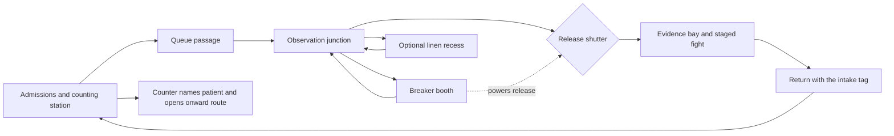

# Production roadmap — earn the next depth

Status: Phase 00 foundation work; new slice implementation has not begun. Work advances by evidence gates, not by promised calendar dates. The existing campaign remains the compatibility reference. [Progress](PROGRESS.md) records actual completion.

## The Intake Bell — authored Depth-1 slice

**Player objective:** restore the release circuit, recover the first patient's intake tag beyond the security shutter, and return it to the counting station. The payoff is a named person restored to the record, a changed party response, and a visibly opened route onward. This is an opening sequence inside Depth 1; it does not replace the guardian or skip `first_corpse` and the existing chapter gate.

**Dramatic question:** why does a room designed to admit people have no functioning record of anyone leaving?

**Design hypotheses:** 12–18 minutes first visit, 45–65 committed main-route steps, one mandatory normal fight, one optional loop of ≤12 extra steps. No random encounter or procedural event interrupts the sequence. The normal encounter is a staged instance of existing enemies and abilities, not a new combat engine. The rest of Depth 1 may retain procedural secondary spaces after the slice proves itself.

### Spatial blockout specification

Proposed 22×20 grid, north at decreasing y, one cell = 2 m. Coordinates below are an implementation brief; the reachability test, not this table alone, proves the built layout. Non-room cells start as walls. Keep one-tile wall separation except listed connectors. Main routes remain valid under all SAN states.

| ID / area | Proposed cells / dimensions | Former use / human trace | Gameplay and camera purpose |
| --- | --- | --- | --- |
| A — Admissions | x2–6, y12–16; 5×5 | Queue rails stop at an empty desk; four used wrist ties, no completed release slip | Spawn (4,15), north. Counter occupies north wall at (4,11); safely learn turn/step/inspect, hear bell once |
| L — Counting station | Face at (4,11), seen from A | Four mechanical name slots; release count stuck at zero | Landmark, objective origin and return payoff; amber task lamp frames it through queue rails |
| Q — Queue passage | x7–12 at y14, then x12 at y10–13 | Repeated bays, one missing rail, drag mark turns the corner | L-shaped connector; narrow threshold → view into a wider junction; no endless generic hall |
| J — Observation junction | x10–14, y7–10; 5×4 | Desk faces patients, not the outside door | Three readable branches: shutter north, breaker east, return south; single sightline to illuminated shutter |
| B — Breaker booth | x16–19, y7–9; connector (15,8) | Release circuit patched around a burned patient-call wire | Required low-risk mechanism; label, inspect and operate share the same range/facing rules |
| S — Linen recess | x16–18, y11–13; connector (14–16,10) then (16,11) | Folded clothes tagged by number; one handwritten name under a shelf | Optional curiosity/reward. Inspect the displaced queue shadow or ordinary shelf clue to find finite supplies |
| G — Release shutter | (12,6), between J and E | Observation slot, worn manual latch, clear lock indicator | Closed door blocks passage; B opens it permanently with audible/visible feedback and objective update |
| E — Evidence bay | x10–14, y2–5; 5×4 | Admission chair turned toward exit; intact tag on a body | First-corpse choice, staged fight and breathing space; framing connects room function to evidence |
| R — Return route | Existing E→G→J→Q→A | Previously unexplained traces become legible | No respawn/ambush; shutter stays open. Restored counter releases next route at (2,14) |

The wall at (4,11) must be visible from the spawn; the east connector needs a visible destination before the player commits. Use contrasting wall mass and a lamp to distinguish J's exits, with text signage as secondary guidance. Test the optional connector for accidental room merging during blockout. Counter/tag/rail are authored world props or wall features, not a background screenshot.

### Beat sequence and ownership

| Beat | Target time / tension 0–5 | Player action and response | Existing system / new work | Acceptance |
| --- | --- | --- | --- | --- |
| 1. The bell | 0–2 min / 1 | Inspect counter: four arrivals, zero releases; objective becomes clear | Existing objective DOM; new landmark/inspect content | Objective understood without a tutorial wall; orientation is safe |
| 2. A witness | 1–3 / 1 | Talk to Keeper. Ask for a name or dismiss the account; companion reacts | Reuse Keeper dialogue/flag pipeline; add compatible slice branch | Reload mid-conversation; preserve later Depth-2 lead and existing intro choices |
| 3. The missing rail | 3–5 / 2 | Follow wear through Q; shutter visible from J before reaching it | Authored sightlines/materials, fluid grid camera | Player recognizes return route; no random interruption |
| 4. Release circuit | 5–7 / 2 | Inspect locked shutter, find accessible B, operate breaker, see shutter lift and light change | New `interact` controller command and persistent mechanism state | Works from keyboard/touch, blocked reason clear, no consumable key or relock |
| 5. Fifth queue shadow | 6–9 / 3→1 | Subject 13 perceives a fifth person following the queue. Observe or ground the party with Anya | Existing SAN stages/effects; new perception flag, accessible log and optional trust response | Never changes legal route. Effects off and high SAN still permit shelf inspection; no forced damage |
| 6. Linen recess | Optional 1–2 / 1 | Find handwritten name and one medkit; acknowledge or dismiss 13's observation | Existing inventory transaction and named memory flag | Exactly once, capacity-safe; a full inventory gives a retry/leave route. Do not grant `staff_memo` early |
| 7. The body and guard | 8–13 / 4 | Resolve existing `first_corpse` choice; then guard + rat bar the evidence bay's return | Existing events/choice effects; staged `createCombatState` with existing enemies | Preserve completion/ending flags. Telegraph before commitment; no surprise lethal roll or second fight on return |
| 8. Return a name | 13–18 / 1 | Take persistent quest tag after encounter; return to L and place it | New one-time tag/interaction, existing item/flag effect boundary | Readable record change, one companion consequence, a recovery supply or safe rest and onward route opens |

**Combat intent:** guard threatens control on a named ally while the rat pressures another. Elias can redirect/protect, Miriam can heal/control, Subject 13 can prioritize damage at SAN cost, Anya can sustain SAN. Show telegraphs in both Canvas and DOM. Start with existing stats and tune only after logs and player sessions; target 3–6 rounds. Allow normal Flee into J without resetting enemy HP/reward; re-entry resumes the encounter. If that resume behavior expands scope, implement an explicitly confirmed commitment with a safe preparation point instead, and record the decision before playtesting. Boss rules stay unchanged.

**Choice consequence:** belief in 13's observation produces a short later acknowledgment at the counter; dismissal produces a different line and keeps the optional clue recoverable. Use a named memory flag before inventing a relationship meter. Preserve a path for each surviving companion; do not gate a required release on a dead party member. The tag identifies the patient, not a surprise replacement for a protagonist's established identity.

**Payoff:** the mechanical counter changes from a number to a name, the release channel opens with a warm bounded light, and the party's earlier choice receives a specific response. Save then reload and the changed space must remain changed. Do not require an extra unmarked lap after all objectives are met.

### Slice validation matrix

Run the main path, ignored-secret path, accepted/dismissed-vision paths, low/high SAN, inventory-full reward, one fallen companion, combat defeat/flee, and reload at counter/breaker/door/event/combat/payoff. Observe no duplicate reward, missing key, reset door, orphan event, trapped player or stale objective. The scenario may route to the existing Game Over on defeat; it cannot present a broken exploration screen.

Required evidence: a room-purpose ledger, state-aware route test, 1280×900 and 390×844 room/corridor/combat/UI captures, continuous uncut walk, muted/reduced-motion run, timing profile and five first-time sessions. The slice is not approved until A–G applicable gates pass. Do not scale a weak room kit to five depths.

## Production phases

| Phase | Deliverable and implementation boundary | Dependency / exit evidence |
| --- | --- | --- |
| 00 — Production contract | Audit actual HEAD; preserve v1 saves; add deterministic capture/comparison/provenance inventory; seven contract docs and AGENTS rules | Commands, images directly inspected, limitations and open gates recorded. No claim of slice completion |
| 01 — Playable authored blockout | `authored/depth1-intake.ts`, map selection for **new runs**, room/beat metadata, reachable breaker/shutter/tag/return loop; existing first-corpse and combat integration | New route/state tests, v1 maps unchanged, complete no-debug route with primitive art. Fix title control overlap as a separate small UI change with viewport evidence |
| 02 — Perspective and controls | Passive map projection/RNG compatibility; camera interpolation; unified surface projection; depth-correct sprites/doors; compact HUD and gated QA tools | Occlusion/near-wall/rotation tests, held-input/reload checks, before/after captures and measured frame/input traces |
| 03 — One coherent room family | Admissions + Q/J with final material/lighting system; one hero/NPC/guard reference family, grounded props, original landmark | In-context/native-scale/grayscale/motion review. Cleared source records before public use; asset and transfer budgets pass |
| 04 — Complete the slice | All beats, perception/relationship response, finite reward, tactical encounter, persistent return payoff and distinct audio cues | Five moderated sessions and fixes, full settings/device matrix, A–G slice disposition. Iterate or cut before expansion |
| 05 — Five-depth production | Reusable validated kit with depth-specific materials/shapes/landmarks; authored mandatory beats and paced secondary generation | Five environment matrices and full campaign/ending routes; seeded reachability and no-cheat playtests; no copy-pasted first-depth rooms |
| 06 — Release candidate | Content freeze, physical-device and listening checks, memory/network testing, rights/credits completion, production-only debug gating and protected deployment | All release gates pass against the exact distribution hash; explicit release action authorization. No automatic publication from this roadmap |

Phases can share a narrow preparatory task, but cannot skip their exit evidence. Commissioning/rights recovery starts early in parallel with local blockout because it is a known release risk; it does not justify mass-producing mismatched final art.

## Prioritized risks and cuts

1. **Playability before scale:** large procedural maps can create wandering without authored meaning. Prove a short purposeful loop and remove unnecessary tiles.
2. **Projection and RNG coupling:** changing renderer initialization changes future random content. Establish migration/legacy-render tests before that refactor.
3. **Style/provenance:** all 45 distributed media files lack file-specific proof. Resolve source rights or replace in a small coherent family; conversion is not clearance.
4. **HUD and input:** essential controls currently fall below the fold. Fix composition while preserving DOM accessibility and existing tests.
5. **GPU assumptions:** local WebGL2 is software SwiftShader. Do not budget a future GPU renderer from those results.
6. **Test overconfidence:** policy tests and screenshots cannot certify fun, speaker mix or physical phone memory. Reserve those reviews explicitly.

Cut optional side rooms, decorative effects and extra enemy types before cutting readable navigation, consequences, save integrity or the final return payoff.

## Exact next implementation step

Implement the **Phase-01 authored intake blockout**: add `src/game/exploration/authored/depth1-intake.ts` returning a `DepthMap` with A/Q/J/B/S/G/E, stable room/feature IDs and no random hazards on the slice route; add `tests/intake-layout.test.ts` proving start→breaker→opened shutter→evidence→counter and optional-cache reachability plus absence of a key-behind-its-own-gate. Integrate through `exploration/map.ts` for new runs only; preserve loaded v1 maps. Add the minimal controller interaction/door state required for that loop, with save/resume tests, then capture the greybox route. Do not begin a renderer rewrite or five-depth art batch before this route is playable.
