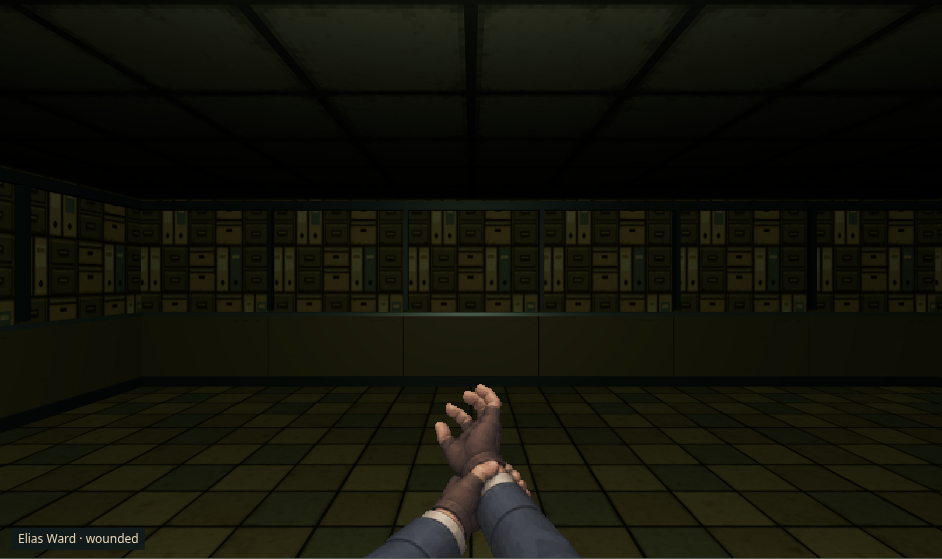
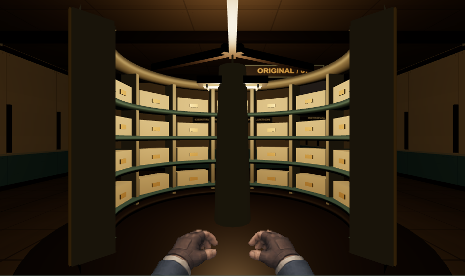

# Phase 02 — playable Archive candidate and evidence

Implemented 2026-11-10; final verification 2026-11-11. **The generation/gameplay integration passes the recorded automated checks. The Archive remains an art-production candidate: material/composition refinement and human artistic/play acceptance are open.** Phase 01A/01B human approval is not inferred. A local development commit was subsequently requested by the owner. No push, publication or deployment is authorized by that request.

## 1. Repository baseline

Initial tree was clean, branch `main`, HEAD `96a2d0aae7c3384379885624d6df687275e5db5f`, matching the supplied reference. Work resumed with the existing Phase 02 changes preserved. The tested application source SHA256 is `27678666628c6eaf4ef09060748a3e058d2728c0f8130fca067caa326752b075`; the canonical build-file manifest SHA256 is `ad5e9d96a92c8bccf3a59446d9d00eab9cf0059ea3aaf523009988996716c10b`. [Manifest](manifest.json) records every source/build and retained evidence hash. The evidence records the pre-commit parent; the implementation is retained in a local development commit at the owner's subsequent request.

## 2. Skills actually applied

[Skill usage](../../PHASE02_SKILL_USAGE.md) records exact installed paths, bodies/references reviewed, concrete decisions and scripts. Actual skills include router, Three.js director/gameplay/scene/material/graphics/UI/debug/QA, procedural-gen, level-design, save-systems, create-game-assets, game-feel and game-ui-ux. No scaffold was generated. The installed pixel inspector was executed through the project's existing real-scene bootstrap adapter; its metrics/assertions were not modified. A direct CLI attempt failed because the DOM-only title has no canvas before scene setup; [that failure](rejected/inspector/pixel-inspection.log) is retained.

## 3. Old-generator defects confirmed from source

`map-generator.ts` uses random rectangle rejection, not recursive BSP; sequential corridors; a connectivity measurement that only warns below 90%; story/features placed after geometry with possible conflicts/omissions; shared `gameRandom`. No invented failed-seed rate is claimed. The original file remains unchanged for legacy continuation.

## 4. New architecture

The new pipeline establishes progression roles/edges before placement, chooses authored room proportions, embeds nonoverlapping rooms with controlled orientation/spacing variation, routes corridors around forbidden geometry, adds a return loop and optional branches, places required features, validates the complete authoritative grid, then supplies plain semantic metadata to presentation. Four deterministic attempts are the hard bound; invalid worlds are rejected rather than warned through.

[World contract](../../PHASE02_WORLD_GENERATION.md) explains `generation/{world-definition,random,archive-rooms,archive,validate}.ts`, map selection, controller and save boundaries. `DepthMap.tiles` remains collision truth. `environment` stores versioned room/edge identity, bounds, purposes, sockets and decoration seeds. It contains no scene, GPU, Canvas or animation objects.

## 5. RNG and save compatibility

Save v3 persists `{ version: 1, runSeed }` only for new-run generation policy. Missing policy retains legacy continuation, including when v3 re-saves an older run. v0–v2 saves do not acquire the new policy. Already-created maps always win over generation.

New Archive layout/features/decoration use pinned FNV-1a-derived independent xorshift32 streams. Layout/feature generation and rendering do not consume the gameplay stream. Cosmetic-salt and call-order tests preserve tiles/layout. Legacy tests enter ungenerated Depth 2 from v1 and pre-Phase 02 authored-Intake v2 saves through the exact original generator/saved stream. All five immutable v1 fixture hashes remain unchanged. Opened latch, finite/partial loot, event flags, party, dialogue flags and RNG survive new Archive reload/re-entry. No viewpoint or acting clock is serialized.

## 6. Graph and templates

There are ten authored roles: transfer entrance, indexing, compressed aisle, filing gallery, central drum, retrieval, restricted evidence, damaged storage, maintenance secret and Ward transfer. Seven main edges, one gated evidence branch, one secret branch and one controlled loop produce ten edges. The gate has an always-reachable INDEX lever; evidence is unreachable before release, reachable afterwards, and unnecessary for the main exit.

The executable [room-purpose ledger](world/room-purpose-ledger.json), [seed130013 map](seeds/archive-130013.png), [labeled map SVG](world/archive-seed130013-map.svg) and [progression graph](world/progression-graph.mmd) are retained. Every template has a former function, human trace and focal point. Current runs always contain all ten roles; broader graph grammars and optional-room omission remain future variety work. This is constrained graph embedding, not a claim of unlimited architectural diversity or classical BSP.

## 7. Archive architecture

`ArchiveRoomRenderer` extends the existing instancing sink with chamfered filing banks, drawer/handle/index detail, tall shelf islands backed by real blocked cells, transfer desks, index machine, twin-spool retrieval, evidence cage, maintenance grille, repair rails and a thick open records drum with a removed quadrant. Room ceilings, practical sockets and route-derived destination lintels distinguish storage, service and central spaces. Supplies use enamel evidence cases with existing opened-state data. Door orientation follows the actual routed threshold.

Archive material roles use umber/paper/ink/task amber and original procedural concrete/floor/signage recipes. Four permanent point-light slots allow two chosen fixtures to retire in place; 220 ms presentation blending avoids full-power light relocation. Static geometry is built once per depth; committed doors/contents update without rebuilding it. Intake, CameraRig, character assets and the primary Three.js renderer were retained. Unknown NPC presentation IDs receive a labeled neutral fallback in both backends rather than Keeper art; unknown/prototype IDs cannot open phantom dialogue.

## 8. Gameplay and narrative proof

The [normal journey](journey/archive-normal-journey.json) used the actual Begin button, normal keyboard/DOM controls and only a pinned entropy source (seed130013). No QA hooks, state/HP injection, debug skips or one-hit options were exposed. It earned linen supplies, prepared inventory, resolved the existing body/security/tag/counter loop and Threshold guardian, entered Archive, operated INDEX, discovered the drum, resolved `riot_recording_event` and `pit_fall_event`, collected a finite maintenance reward, saved/reloaded at the exit, defeated the Archive guardian, entered Depth 3, returned by the real stair and reloaded again.

Recorded: 46 combat actions across guard+rat, Threshold Warden and Keeper of Records; all three established event IDs; zero browser errors; all four protagonists alive at the final return. Existing choice consequences and guardian rules remain. The Archive's named choices and guardian provide its initial pressure; ordinary random corridor encounters/story-pool interruptions are not placed on this new route. This is a deliberate initial pacing decision requiring human play review, not a combat rewrite.

[Uncut normal-journey video](journey/archive-normal-journey.webm) and real entry/drum/exit/guardian-return PNGs accompany the state report. Automated map-aware routing is not an uncoached human playtest.

## 9. Phase 01B integration

The existing PresenceDirector/View, hand/body atlases, CameraRig and shared 143/403/650 ms combat presentation markers remain. Accepted INDEX/inspect/cabinet commands commit effects before existing gestures; an empty/full cabinet search cannot imply a successful pickup. No new hand renderer, acting clock, camera bob/shake/FOV change, party followers or gameplay animation callbacks were added.

All four living viewpoints were tested in central and actual-interaction fixtures, full/reduced motion, desktop/mobile, WebGL2 and labeled Canvas fallback. Existing combat/identity/focus/touch assertions pass. Viewpoint changes leave authoritative state/RNG unchanged. Ten explicit Intake→Archive shell round trips retain one world and one PresenceView; 200% text has no horizontal overflow at 1280/390/320 px. CDP frozen/active and second-tab activation preserve the raw save; headless Chromium reported `document.hidden=false`, so true hidden-tab behavior remains unverified. See [integration diagnostics](reports/integration-probe.json).

A full-suite failure exposed a pre-existing title-loading poll rerendering exploration and changing only `savedAt`. The poll now requires its original connected title shell and title mode. The original raw-save assertion remains; a delayed-load regression was added. [Failed run](rejected/title-poll-browser-failure.log), [focused pass](logs/presence-regression.log) and final suite remain separate.

## 10. Visual evidence and direct review

[Capture report](captures/report.json): **82 cases / 164 PNGs**, desktop1280×900 and mobile390×844, DPR 1, seed130013. Seventy-eight use actual WebGL2, two are deliberately labeled Canvas fallback and two are the existing Canvas combat view. All ten room roles, four protagonist central/interaction pairs, normal/reduced motion, grayscale, finite-container architecture and representative combat are included. Two fixture/motion recordings contain 45 connected legal input steps each. They start from labeled isolated fixtures and do not prove campaign progression.

[Desktop connected motion](motion/1280-archive-fixtures-and-connected-motion.webm), [mobile connected motion](motion/390-archive-fixtures-and-connected-motion.webm). The lead inspected native key views, all ten room crops, four protagonist pairs, grayscale/legacy views and sampled consecutive movement frames. This is model inspection, not owner artistic approval or listening review.

The legacy Depth 2 comparison is the immutable v1 checkpoint rendered by the current compatible backend, not a claimed same-room image from the old commit. Its complete map differs from the new Archive.

The first near-black entrance was rejected and retained in [rejected/underlit-entry.png](rejected/underlit-entry.png). Practical/fill corrections restored basic functional read. New cabinet compression, open drum silhouette and grounded hands now read clearly; quieter rooms remain too flat/dark for the requested final commercial bar. Gallery framing and decorative drum-label occlusion need another art pass. No baseline was rewritten to certify them.

## 11. Seed validation

Normal units sweep 100 fixed Archive seeds. The [extended report](seeds/seed-validation.json) records **1,000/1,000 distinct valid maps**, all accepted on attempt0, 243–266 traversable cells, ten rooms/ten edges. Nine generator cases include deterministic repeat output, versioning, required reachability, closed/open gate solution, feature/ID/overlap/corridor checks, invalid-world rejection, gameplay-RNG isolation, cosmetic independence, legacy continuation and per-seed mutated save round trips. These results apply only to Archive; Depths 3–5 retain the old generator.

## 12. Commands and browser results

[Exact final command ledger](command-results.json) records timestamps, environments, individual logs and exit codes for the eleven serial verification jobs. Initial `npm ci`, standalone build/typecheck, provenance and security checks are recorded in [validation](../../PHASE02_VALIDATION.md). All required commands were executed; no reported pass represents an unexecuted command.

| Check | Result |
| --- | --- |
| Typecheck / event validator / units | 0; 83 events, 7 pools, 115 units in23 files |
| Extended Archive suite | 0; 9 cases /1,000 seeds |
| Production build / atlas checks | 0;35.5/45 MiB; retained >500kB lazy-renderer warning |
| Full browser smoke | 0;25 cases, full-motion normal journey included |
| Frozen-save baseline | 0;6 scenes |
| Intake golden capture | 0;10 scenes |
| Character pair capture | 0;28 cases |
| Presence capture | 0;60 cases |
| Archive capture | 0;82 cases, zero errors/failures |
| Provenance inventory | 0;122 files,41distributed unverified |
| Security audit | 0;zero known vulnerabilities |
| Installed pixel inspector | 0;2hardware WebGL2 scenes; entropy3.88/3.80, contrast168.7/63.0, edge density.226/.261 |

Linux-sandbox subprocess/capture failures were rerun with required permissions, without weakening tests. The direct inspector bootstrap and temporary probe-context mistakes are retained as harness failures. Scripts/tests added for Phase 02 extend the existing project tooling; no framework was replaced.

## 13. GPU and resource measurements

Host: Intel i7-1165G7, Linux7.1.5+kali-amd64, Node24.13.0/npm11.19.1, pinned Chromium158.0.8127.18; ANGLE/Mesa **Intel Iris Xe TGL GT2, OpenGL4.6, actual WebGL2**. Full Chromium uses `--enable-gpu`; no software-vendor relabeling or blocklist override. Both movement profiles use a five-second warmup then 60 seconds of real input, DPR 1, full motion. Mobile4× is CPU/viewport emulation.

| Scenario | Frame median / p95 | CPU submission p95 | Other measured scope |
| --- | --- | --- | --- |
| Intake1280×800 |16.7 /16.7 ms|1.3 ms|3,608 frames;38calls at final view |
| Intake390×844,4× |16.7 /16.8 ms|2.1 ms|3,610 frames;39calls at final view |
| Archive1280×900 |16.7 /16.8 ms|1.1 ms|3,617 frames;15calls at final view |
| Archive390×844,4× |16.7 /16.7 ms|2.0 ms|3,623 frames;16calls at final view |

Compared with the retained Phase01B report on the same Iris Xe/browser profile, Intake p95 changes from16.7/16.7ms to16.7/16.8ms (desktop/mobile4×); CPU submission changes1.4/2.0→1.3/2.1ms. The0.1ms mobile increase remains within the unchanged budget. Archive's desktop viewport is900px high rather than the inherited Intake800px profile; its result is a separate environment measurement, not a pixel-identical before/after comparison.

Zero recorded long tasks in all four profiles. These pass the unchanged20 ms desktop/40 ms emulated frame thresholds. Archive scene captures range up to 76 draw calls; final-view counts above are not route maxima. Eight geometries and26resident textures after the warm Archive route; estimated decoded texture bytes8,519,680 (~8.1 MiB), excluding driver/process allocations. No extra postprocessing/shadow pass. Commit-to-first-submitted-camera-frame p95 is16.9/17.6 ms, explicitly excluding OS input and queued waiting.

Archive fixture-to-renderer-ready timing is289.2/498.0 ms desktop/mobile 4×; this includes UI/assets/first render, not isolated geometry construction or input-to-photon. Fresh-context non-audio transfer through the Archive benchmark is1,047,492 bytes, versus1,532,011 for Intake. Neither is a controlled-network or physical-phone certificate. Canvas combat proxy (80 warm samples) p95=.5/1.0 ms, under 16.7/33 ms budgets.

Ten forced-GC Archive round trips show one active renderer/presence and stable resource counts. JS heap grows5,288,676→6,657,192 bytes, with the final five samples6,550,248–6,687,348. This short warmup/plateau observation does **not** establish bounded long-session/process/GPU memory. [Intake report](reports/performance-intake.json), [Archive report](reports/performance-archive.json), [resource report](reports/integration-probe.json).

## 14. Provenance

No new binary environment media or character art was imported/generated. Original code-authored modules/surface recipes are recorded in `ASSET_PROVENANCE.json` with originality/contributor review pending. Existing source/runtime art separation, atlas hashes, legacy records and dependency notices remain. The inventory passes122 files with41distributed legacy media records still unverified; no new public release is cleared.

## 15. Remaining production gates

- **Visual S1/open:** stronger quiet-room materials/value hierarchy and gallery focal composition; decorative drum-label clearance; owner/art-director approval of Archive and the retained Phase 01A/01B family/acting. The implementation is not certified premium/showcase.
- **Gameplay/human S1/open:** five uncoached sessions, landmark recognition, optional-route value, tactical/pacing and enjoyment review. Automated completion does not establish fun.
- **Device/accessibility/performance open:** physical phone, true hidden tab, long-session process/GPU memory, input-to-photon, manual reader/listening/physical touch. Existing short hardware/DOM checks do not substitute.
- **Variety/content scope:** all ten rooms currently occur; further grammars/optional omission and other depth kits are not delivered. Depths 3–5 keep their old generation/content.
- **Rights/public release S0:**41legacy distributed records remain unverified; no publish/deploy is authorized.

The installed ten-category rubric, interpreted for embodied turn-based exploration, remains below its premium threshold. Lead's provisional before→after scores: direction1→2; protagonist2→2 (retained); enemies1→1 (legacy); interactions1→2; world1→2; materials1→1.5; lighting1→1.5; motion2→2 (retained); HUD2→2; performance evidence1→3. Mean after=1.9; categories below2 remain. Pixel metrics from two signature views do not override the full room-set critique. This score is an internal model review, not human approval.

## 16. Exact next production action

Review the native Archive rooms, all four embodied viewpoints, grayscale and uncut normal journey with the owner/art director. Record accepted/rejected compositions; refine quiet-room material/light grouping, gallery sightline and drum-label clearance. Then run five uncoached sessions and the planned physical Pixel6a route, documenting navigation/pacing/tactical corrections and real memory/accessibility results before expanding the kit to remaining depths. Preserve all historical Phase 01/01A/01B evidence and open rights gates.
