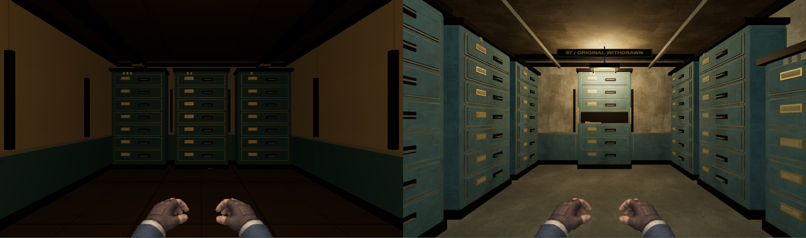
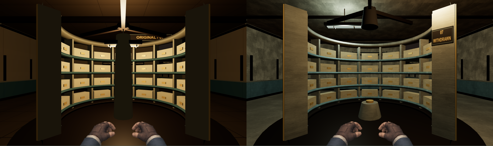
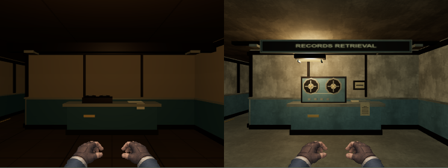

# Phase 02A — Archive visual polish evidence

**Implemented visual-polish candidate. Human artistic approval: PENDING HUMAN REVIEW.** Prepared for a local development commit at the owner's subsequent request after validation. No public release, push or deployment. [Matched interactive comparison gallery](comparisons/index.html) contains96 pairs; the PNGs below place before on the left and after on the right.

## 1. Verified baseline

Clean `main` at `a55290ff3755ae802c547d630593870d59514934`; origin `git@github.com:polsala/Depths-of-the-Fractured-Mind.git`. Baseline fresh build/capture precedes source edits. Phase 01/01A/01B/02 history and all seven files in the immutable-v1 corpus remain unchanged, including its five save payloads. [Manifest](manifest.json) records file hashes, protected source boundaries, build hashes and environment. The reports and gallery captions preserve their pre-commit capture context.

Tested application source SHA256: `03db1fbe2a121ce363e357654aef1ca21a9b4b6fcc06522ac893dbf937b15b88`. Sorted distribution-manifest SHA256: `7337125a8bc3d3f6a6f397ec0ec6ac458c97a16ede6af618162b1090198f3937`. Raw capture reports contain each distribution file hash; material source/runtime hashes are separate. Documentation and utilities are outside the application-source digest; the seal utility has its own hash.

## 2. Skills and specialist ownership

[Skill register](../../PHASE02A_SKILL_USAGE.md) names actual installed paths, read references, scripts and affected files. Router/director, graphics-builder, materials-lighting, scene-setup, create-game-assets/imagegen, level-design, game-feel, debug-profiler and QA-release were applied. Three workers owned materials, lighting and composition; the lighting specialist then performed independent visual QA, with lead-owned integration/performance. [Production notes](production/) retain concrete decisions. No scaffold was generated.

## 3. Initial artistic defects

[Defect ledger](defect-ledger.json) records all ten scenes with exact camera/location/viewport, severity, player impact, cause, intended correction and before screenshot. Fresh images confirm flat/dark quiet rooms, a weak three-bank gallery end, drum shaft/label occlusion, repeated surface stretching, eye-invisible tape reels, nearly identical transfer stations and posts crossing room titles. Findings came from actual game pixels, not historical scores alone.

## 4. Code and asset changes

`ArchiveRoomRenderer`, `ArchiveLighting`, `LightingSystem`, `MaterialLibrary` and the Archive-only floor-role selection in `SceneBuilder` change presentation. New material-builder/capture/comparison/sealing tools extend existing infrastructure; two focused test files add four regressions. **Generation, save, game rules, CameraRig, protagonist atlases, presence, combat timing and original generator are unchanged.** The seal checks protected paths against the baseline. No feature, reward, gate, event ID or legal tile changes.

## 5. Materials

One original 1536×1024 six-swatch master produces six 256×256 albedo and sixpacked height/roughness WebPs. Concrete, enamel, linoleum, service aggregate, steel and paper share world sampling at256 px / 2 m. Paint/steel roughness and metalness differ; height is restrained. Source/prompt/raw metadata/derivatives/provider-use observations are retained under `source-assets/environments/archive-phase02a/`. Runtime total **468,372 bytes**, base decoded3 MiB before mipmaps. [Material manifests](materials/) trace every derivative. No third-party texture/input image was used. Broad concrete repetition remains a localized S2 concern.

## 6. Lighting

Shared pure derivation supplies physically aligned warm task/cool structural fixtures without changing saved sockets. Room pairs remain stable across their floor; corridor retention bias and220ms retirement use the existing update clock. Four permanent PointLights remain bounded, including rapid transitions. Quiet tasks receive motivated local light; narrower asymmetric hoods avoid their signs. No bloom, new animation clock, camera effect, post pass or Archive shadow pass was introduced.

## 7. Gallery

Filing ranks now follow the long walls in both orientations. Height changes, an interrupted return bench, receding ceiling rails and a lit withdrawn-original bay create foreground/middle/far structure. Both gallery ends were captured in130013/130014/73021 at both viewports. The empty drawer and pale mounting trace survive grayscale. Text becomes legible on approach; its distant size remains S2. [Approach studies](after/studies/report.json) and [matched camera checks](comparisons/study-pairs.json) retain unflattering opposite-end views too.

## 8. Records drum

Split bearing stubs replace the full-height shaft, opening the central void. The missing quadrant, thick open rings, interrupted track and exposed cut faces remain. The identifier is flush to the right radial cut face, entirely contained in the final front desktop/mobile views. The solid3×3center and legal perimeter remain authoritative and unchanged. Four approaches across three seeds were reviewed; rear/side record arcs communicate the missing quadrant less strongly, recorded as S2 rather than hidden.

## 9. Quiet rooms

Received records use a roller cradle/cancelled consignment; Ward transfer uses sealed folios/recipient pocket/paired locks. Index adds rollers, an absent numbered band and manual dial/lever. Retrieval exposes upright reels and interrupted transcription. Service storage exposes a hoist/inspection mechanism; maintenance has a displaced panel, service card and medical-packet trace. Existing cage/original bundles and storage functions remain. Room titles clear structures and task hoods; the small maintenance room uses a lower opening plate. [Room ledger](after/captures/room-purpose-ledger.json) is byte-identical to before.

## 10. Before/after and direct inspection

Each main pass contains **82 cases/164 PNGs**: both required DPR 1viewports, all ten roles, normal/reduced motion, four protagonist central/accepted-interaction pairs, grayscale drum, combat and labeled Canvas fallback. Additional **56 studies/pass** cover all-room grayscale and multi-seed gallery/drum approaches. Forty main room pairs plus56 study pairs match exact camera/location/seed/viewport/quality. Canvas fallback and Canvas combat are explicitly labeled; they are not WebGL2 proof.

[Lead inspection ledger](reports/lead-inspection.json) lists exact native images and motion sheets directly inspected. [Independent review](reports/independent-visual-review.json) lists53 exact paths, including all ten desktop/mobile normal rooms, representative reduced/grayscale/hero scenes and additional seeds. This does **not** claim every retained PNG or every video frame was manually inspected. Source/repeat previews were inspected separately and never substituted for in-game quality.

[Rejected iterations](rejected/) retain the first hood/title overlap, bright cabinet hotspot/cropped floating plaque, and revision2's hidden cut-face tag/over-high maintenance title. The final corrected views are separate; no baseline was blindly replaced.

## 11. Real movement and gameplay

[Uncut normal-input journey](journey/archive-normal-journey.webm) uses no QA route: Begin → Intake/Keeper/security/body/tag/guardian1 → Archive/INDEX/drum/both required events/finite maintenance reward → save/reload → guardian2/Depth 3 → real return/reload. All four protagonists remain alive;46 combat actions, the same established three event IDs, zero browser errors. Gameplay RNG matches Phase 02 exactly: before Archive-exit reload `1802684003`, final return `4253242746`. This is map-aware automation, not an uncoached play session.

[Desktop connected recording](after/captures/1280-archive-fixtures-and-connected-motion.webm) and [mobile recording](after/captures/390-archive-fixtures-and-connected-motion.webm) start with labeled isolated fixtures, then45legal connected steps each. Lead inspected ten consecutive5fpsframes at desktop35s/mobile20s: stable light/material placement, lower-frame hands, readable transitions and drum reveal. Desktop20s is a stationary interaction fixture, explicitly not movement proof. Recordings contain strafing/wall-facing moments and are retained without flattering edits. [Motion sheets](inspection/) retain those samples.

## 12. Tests, seeds, captures and lifecycle

[Exact16-command ledger](reports/command-results.json) records timestamps, environments, exit codes and original artifact log paths; corresponding raw bytes are retained as `logs/<name>.txt`. Git also ignores directories named `logs`, so this milestone's 22 sealed logs are explicitly force-included in the authorized commit and checked against the manifest.

| Executed command | Exit / observed result |
| --- | --- |
| `npm run typecheck` |0, strict TS |
| `npm test` |0;119 tests / 25 files;83 events / 7 pools |
| `npm run build` |0;36.0/45MiB; existing >500kB lazy-chunk warning retained |
| `npm run test:smoke` |0;25 browser cases; full-motion normal journey included |
| `npm run validate:archive` |0;1,000 distinct valid Archive maps, zero failures;9 cases; no Depth 3–5 claim |
| `npm run assets:provenance` |0;147 inventoried,41 distributed unverified,zero inventory failures |
| `npm run audit:security` |0;zero known vulnerabilities |
| `npm run baseline:capture` |0;6 frozen-save scenes |
| `npm run capture:golden` |0;10 Intake scenes |
| `npm run capture:characters` |0;28 character cases |
| `npm run capture:presence` |0;60 presence cases |
| `npm run capture:archive` |0;82 cases,zero errors/failures |
| `node utils/capture-archive-studies.mjs` |0;56grayscale/approach studies |
| `npm run bench:dungeon` |0twice, Archive and unchanged Intake profiles |
| `npm run bench:combat` |0;80 warm samples/profile; p95.2/1.0ms |

No install was needed for this refinement; the existing lockfile/node_modules from Phase 02 were retained. New actual-geometry eye-clearance checks cover100 fixed seeds with no collision/RNG/map mutation. Light tests cover100-seed closed-wall anchors, room stability, four-slot bounds and rapid retirement. All original save/legacy/presence/accessibility assertions remain.

Installed pixel inspector:20 actual hardware WebGL2 room/viewport pairs pass, all within its unchanged budgets. Entropy4.16–5.35bits, edge density.179–.309, contrast70.4–146, dominant share.064–.225. These signals support readability, not artistic acceptance. `/usr/bin/python3`3.14.8 ran the installed evidence checker successfully for all20 portable manifest entries. Default `python3`3.6.15 cannot parse its future-annotations import; that tool/environment failure is retained without editing the installed skill. Earlier material encoder/EPERM and optional contact-sheet/Pillow limitations are recorded separately.

Ten additional forced-GC Intake→Archive shell round trips keep one renderer, one PresenceView and one static scene build;8geometries/23textures at the identical central view. Heap5.30→6.89MB, final five6.87–6.91MB: short warmup observation, not long-session process/GPU certification. 200%text has no horizontal overflow at1280/390/320. Frozen/active and second-tab save passivity pass; `document.hidden` remainedfalse, so true hidden-tab behavior is unverified.

## 13. Performance comparison

Host/profile matches retained Phase 02: Intel i7-1165G7/IrisXe Mesa TGLGT2 OpenGL4.6, actual WebGL2/full Chromium158.0.8127.18, Node24.13.0/npm11.19.1, Linux7.1.5+kali-amd64. DPR 1/balanced/full motion,5s warmup plus60s real-input route, serial browser jobs. Mobile390×844/CPU4× is emulation. Desktop Archive remains1280×900; inherited Intake remains1280×800.

| Archive measurement | Phase 02 | Phase 02A |
| --- | --- | --- |
| Desktop median/p95 frame |16.7/16.8ms|16.7/16.7 ms |
| Mobile4× median/p95 frame |16.7/16.7 ms|16.7/16.7 ms |
| CPU submission p95 desktop/mobile |1.1/2.0ms|1.2/2.1 ms |
| Fixture→ready desktop/mobile |289.2/498.0ms|317.7/577.2ms |
| Fresh non-audio transfer |1,047,492bytes|1,522,133bytes |
| Warm geometries/resident textures |8/26|8/36 |
| Estimated decoded textures incl. mip estimate |8,519,680bytes|12,124,160bytes (~11.6MiB) |
| Capture maximum draw calls |76|79 |
| Distribution |35.5/45MiB|36.0/45MiB |

Zero long tasks/browser errors; capture maximum67,234triangles,8geometries,36resident textures; no post/shadow pass. Benchmark final-view calls19/20 are **not** route maxima. Grid commit→first submitted camera-frame p95=17.1/17.1ms, excluding OS/queued input. Readiness includes UI/assets/first render, not isolated construction. New textures explain most474,641extra transfer bytes and bounded texture cost; CPU+0.1ms remains inside unchanged budgets. Intake p95=16.7/16.7 ms, CPU1.3/2.1 ms. [Raw Archive](reports/performance-archive.json) and [Intake](reports/performance-intake.json) reports retain exact values. No physical-phone, controlled-network, GPU-timer, long-session memory or input-to-photon certification is claimed.

## 14. Provenance

Original-input image generation, separate source/runtime files, exact prompt/output hash, deterministic derivatives and freshly inspected official provider-use terms are retained. Backend model/seed/cost were not exposed; raw credentials container is not cryptographically validated. No exclusivity/copyright eligibility guarantee or negotiated account exception is asserted.147-file inventory passes with the **same41 unverified distributed legacy records**. Public release remains blocked; this polish does not clear legacy media or human art acceptance.

## 15. Quality review and remaining gates

The actual installed0–3 rubric and its three calibration anchors were used. [Detailed review](reports/quality-review.json) gives evidence per category. This is an internal model assessment, not human approval or a claimed1–5conversion.

| Category / genre equivalent | Fresh before → after |
| --- | --- |
| Art direction / records institution |2→2.5 |
| Hero / embodied protagonist |2→2, unchanged |
| Obstacles/enemies / retained guardian art |1→1, outside scope |
| Interactions / index, recording, caches |2→2.5 |
| World / room composition |2→2.5 |
| Materials |1.5→2 |
| Lighting |1.5→2 |
| Motion / grid and gestures |2→2, unchanged |
| HUD |2→2, unchanged |
| Performance evidence |3→3 |

Mean1.9→2.15; affected Archive categories average2.3. Whole-game premium threshold is **not certified**, including the retained enemy category below2. No remaining S1 was observed in the53independently inspected final frames. Four S2 refinements remain: thin hanger crossing a compressed-aisle decorative label; close-wall concrete repetition; weaker rear/side missing-segment reading; distant gallery label size. The readable main lintel, focal silhouette and DOM objective remain available. These are scheduled owner-review items, not concealed passes.

A automated tested flows pass; B human visual acceptance **PENDING HUMAN REVIEW**; C uncoached navigation/landmark recognition/pacing/fun unmeasured; D short hardware frame thresholds pass with physical/long-session gates open; E automation/reflow passes with manual reader/listening/touch/true-hidden-tab open; F existing story content preserved with human narrative acceptance open; G public distribution blocked by legacy rights. No historical gate is waived.

## 16. Exact next production action

Review the96matched pairs, native four-protagonist views, grayscale and uncut journey with the owner/art director. Record accepted/rejected treatments for the four S2 items and formal artistic disposition. Then run five uncoached Archive navigation/pacing sessions and physical Pixel6a validation before expanding to another depth. **Do not infer approval, begin Phase 03 or publish from these automated results.**
